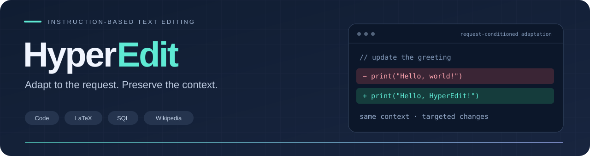
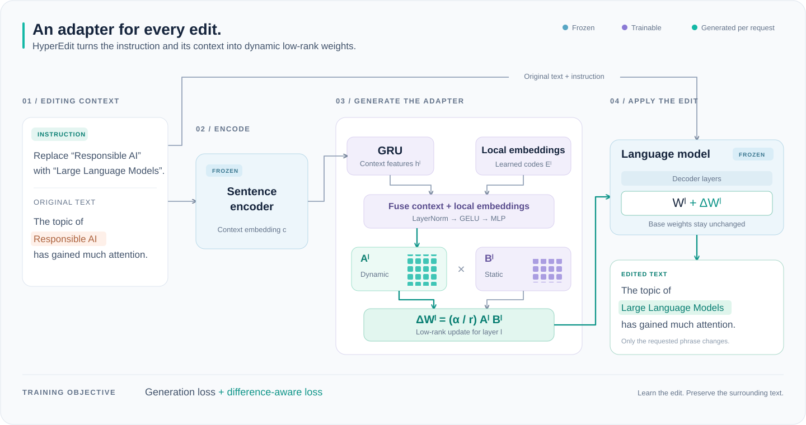

<p align="center">
  
</p>

<p align="center">
  <strong>Unlocking Instruction-based Text Editing in LLMs via Hypernetworks</strong>
</p>

<p align="center">
  <a href="https://aclanthology.org/2026.findings-acl.22/"></a>
  <a href="https://arxiv.org/abs/2512.12544"></a>
  <a href="https://aclanthology.org/2026.findings-acl.22.pdf"></a>
</p>

<p align="center">
  <a href="#overview">Overview</a> ·
  <a href="#method">Method</a> ·
  <a href="#quick-start">Quick start</a> ·
  <a href="#training">Training</a> ·
  <a href="#inference">Inference</a> ·
  <a href="#citation">Citation</a>
</p>

---

## Overview

**HyperEdit** adapts a language model to each editing request through a lightweight hypernetwork. Given an instruction and the original text, it generates dynamic LoRA parameters that guide the edit, while difference-aware supervision focuses learning on the content that should change.

| 🧬 Adapt to each request | 🎯 Focus on the edits | 🧊 Keep the backbone frozen |
| :--- | :--- | :--- |
| Generate low-rank parameters from the instruction and its context. | Apply additional supervision to modified tokens. | Train the hypernetwork and adapter parameters while freezing the language model and sentence encoder. |

The code supports editing across **Code, LaTeX, SQL, and Wikipedia text**, with both single-turn and sequential multi-turn inference.

## Method

<p align="center">
  <a href="https://arxiv.org/html/2512.12544v1#S1.F1">
    
  </a>
</p>

<p align="center">
  <em>Context-aware dynamic weight generation — Figure 1 from the <a href="https://arxiv.org/html/2512.12544v1#S1.F1">HyperEdit paper</a>.</em>
</p>

1. **Encode the editing context.** A frozen sentence encoder embeds the instruction together with the original text.
2. **Generate the adapter.** The hypernetwork combines contextual features with layer-specific embeddings to produce a dynamic LoRA matrix for each target layer.
3. **Apply the edit.** Low-rank updates guide the frozen language model; a difference-aware training loss emphasizes modified tokens.

## Quick start

```bash
git clone https://github.com/StuRinDQB/hyper_edit.git
cd hyper_edit

python -m venv .venv
source .venv/bin/activate
python -m pip install torch transformers sentence-transformers nltk
```

Place your datasets under `data/` and use a checkpoint produced by the training scripts below. The examples use **Qwen2.5-3B-Instruct** as the language model and **Qwen3-Embedding-0.6B** as the sentence encoder.

<details>
<summary><strong>📄 Dataset format</strong></summary>

Training data is a JSON array with `context`, `edit_request`, and `edit_content`. For inference, include an `id`; `edit_content` is optional and is saved as the reference when present.

```json
[
  {
    "id": "example-001",
    "context": "print(\"Hello, world!\")",
    "edit_request": "Change the greeting to Hello, HyperEdit!",
    "edit_content": "print(\"Hello, HyperEdit!\")"
  }
]
```

</details>

## Training

Choose how to identify the tokens receiving additional difference-aware supervision:

| Variant | Entry point | Diff mask |
| :--- | :--- | :--- |
| **Gold** | [`hyper_light_train_gold.py`](Train_Light/hyper_light_train_gold.py) | Derived from the original text and reference edit |
| **Predicted** | [`hyper_light_train_pre.py`](Train_Light/hyper_light_train_pre.py) | Derived using model predictions |

### Gold diff mask

```bash
python Train_Light/hyper_light_train_gold.py \
  --model Qwen/Qwen2.5-3B-Instruct \
  --sent_model Qwen/Qwen3-Embedding-0.6B \
  --train_files data/code_benchmark_train.json \
                data/latex_benchmark_train.json \
                data/sql_benchmark_train.json \
                data/wiki_benchmark_train.json \
  --out_dir checkpoints/hyperedit_gold \
  --diff_mask_mode gold \
  --rank 8 --num_codes 16 --gru_layers 2 \
  --sent_max_len 2048 --max_len 4096 --max_chunk_tokens 2000 \
  --epochs 2 --lr 2e-5 --batch_size 1 --accum 4
```

### Predicted diff mask

Use the same arguments with `Train_Light/hyper_light_train_pre.py`, set `--diff_mask_mode pred`, and choose a separate output directory such as `checkpoints/hyperedit_pred`.

## Inference

### Single-turn editing

Run batched inference with an independent adapter for each example:

```bash
python single_hyper_infer.py \
  --ckpt checkpoints/hyperedit_gold/epoch2.pt \
  --inputs data/code_benchmark_eval.json \
           data/latex_benchmark_eval.json \
           data/sql_benchmark_eval.json \
           data/wiki_benchmark_eval.json \
  --out_dir outputs/single_turn \
  --batch_size 4 \
  --max_chunk_tokens 2000 \
  --max_new_tokens 2000
```

Set `--batch_size` to suit available GPU memory. Add `--limit 2` for a small trial run, and choose a new output directory for each run.

<details>
<summary><strong>📦 What gets saved?</strong></summary>

| File | Contents |
| :--- | :--- |
| `*_predictions.jsonl` | Predictions written after each batch |
| `*_predictions.json` | Complete predictions for each input dataset |
| `manifest.json` | Checkpoint and input hashes, generation settings, and model metadata |
| `status.json` | Progress and completion status |

Each prediction includes the original context, edit request, generated edit, and batch timing. A supplied `edit_content` is retained as `reference`. This entry point generates predictions for subsequent scoring.

</details>

### Multi-turn editing

Apply a sequence of requests to the evolving text:

```bash
python multi_hyper.py \
  --ckpt checkpoints/hyperedit_gold/epoch2.pt \
  --inputs data/multiturn.json \
  --out_dir outputs/multi_turn \
  --max_chunk_tokens 2000 \
  --max_new_tokens 2000
```

In each record, `edit_request` can contain numbered `<Edit Request 1>...</Edit Request 1>` blocks, or one request per line. Each edit operates on the result of the previous one.

## Evaluation

For **average Diff-BLEU**, compute a sentence-level BLEU score for each example's reference and generated diffs, then average within each dataset. Report the overall result as the **macro average** across the four domains:

$$
\mathrm{Overall\ Diff\text{-}BLEU}
= \frac{\mathrm{Code} + \mathrm{LaTeX} + \mathrm{SQL} + \mathrm{Wiki}}{4}.
$$

Each domain has equal weight. Apply the same domain-level averaging to Diff-ROUGE-L F1.

## Code map

| File | Role |
| :--- | :--- |
| [`Train_Light/hyper_light_train_gold.py`](Train_Light/hyper_light_train_gold.py) | Training with a gold diff mask |
| [`Train_Light/hyper_light_train_pre.py`](Train_Light/hyper_light_train_pre.py) | Training with a predicted diff mask |
| [`single_hyper_infer.py`](single_hyper_infer.py) | Batched single-turn prediction export |
| [`multi_hyper.py`](multi_hyper.py) | Shared lightweight HyperLoRA components and sequential editing |
| [`hyper_infer_ST_4096.py`](hyper_infer_ST_4096.py) | Sentence-encoder inference with strict lightweight checkpoint loading |
| [`tests/test_hyper_infer_ST_4096.py`](tests/test_hyper_infer_ST_4096.py) | CPU checks for loading, training parity, and adapter state |

<details>
<summary><strong>🧪 Run the inference regression checks</strong></summary>

```bash
python -m unittest discover -s tests -p 'test_hyper_infer_ST_4096.py' -v
```

The checks cover gold and predicted checkpoint compatibility, per-example LoRA injection, strict loading failures, and state cleanup after generation errors. They run on CPU without downloading model weights.

</details>

## Citation

If HyperEdit is useful in your research, please cite our paper:

```bibtex
@inproceedings{zeng-etal-2026-hyperedit,
  title = "{H}yper{E}dit: Unlocking Instruction-based Text Editing in {LLM}s via Hypernetworks",
  author = "Zeng, Yiming and Cao, Jinghan and Li, Zexin and Yu, Wanhao and Ye, Zhankai and Xiang, Dawei and Hua, Ting and Liu, Xin and Gao, Shangqian and Yu, Tingting",
  booktitle = "Findings of the Association for Computational Linguistics: ACL 2026",
  year = "2026",
  publisher = "Association for Computational Linguistics",
  pages = "466--480",
  doi = "10.18653/v1/2026.findings-acl.22",
  url = "https://aclanthology.org/2026.findings-acl.22/"
}
```

<p align="center">
  <a href="https://aclanthology.org/2026.findings-acl.22/">Read the paper</a> ·
  <a href="https://github.com/StuRinDQB/hyper_edit/issues">Discuss an idea</a> ·
  <a href="#">Back to top ↑</a>
</p>
